  

  

 

  <h3>真实的开发日常 · My Reality</h3>
  
作为一个底层逻辑的“盲目”信徒，我深信：<b>“只要终端环境配得足够花哨，别人就不会发现我还在 Google 翻转二叉树。”</b> 目前正致力于将散发着腐烂气息的“上帝类 (God Class)”送进历史垃圾堆，顺手折腾离线 7B 桌面助手 <code>local_agent</code> 和 <code>cyh.codes</code> 云端工作区。

  
<b>目前正在死磕：</b>手动管理内存（并专业地制造内存泄漏），以及强迫症般地推崇 3NF / BCNF 数据库规范化。

  
<b>Vibe Coding 践行者：</b>5 分钟指挥 AI 写出脚手架，再花一整天修它的架构幻觉——直到干脆给它焊了沙箱和一键 Undo。

  
<b>工程底线：</b>拒绝一个 <code>switch</code> 塞一万行逻辑！代码可以跑得慢，但绝对不能不符合设计模式规范。

 

  

 

  

  <h3>赖以生存的技术栈 · Surviving With</h3>
  

    <picture>
      <source media="(prefers-color-scheme: dark)" srcset="https://skillicons.dev/icons?i=py,java,c,mysql,postgres,redis,docker,vim,powershell,git,github&theme=dark" />
      <source media="(prefers-color-scheme: light)" srcset="https://skillicons.dev/icons?i=py,java,c,mysql,postgres,redis,docker,vim,powershell,git,github&theme=light" />
      
    </picture>
  

 

  <h3>极其真实的算力消耗 · CPU &amp; Brain Usage</h3>
  

    
    
  

  

    
    
  

 

  

  <h3>努力的证明 · Just to Show I'm Alive</h3>
  

    <picture>
      <source media="(prefers-color-scheme: dark)" srcset="https://streak-stats.demolab.com/?user=Cyh-codes&theme=dark&hide_border=true&ring=FF5722&fire=FFB86C&currStreakLabel=FFB86C" />
      <source media="(prefers-color-scheme: light)" srcset="https://streak-stats.demolab.com/?user=Cyh-codes&bg_color=fffde7&title_color=333333&text_color=555555&icon_color=ffb86c&border_color=ffe0b2&fire=ffa000&ring=ffb300" />
      
    </picture>
  

  

    <picture>
      <source media="(prefers-color-scheme: dark)" srcset="https://raw.githubusercontent.com/Cyh-codes/Cyh-codes/output/pacman-contribution-graph-dark.svg" />
      <source media="(prefers-color-scheme: light)" srcset="https://raw.githubusercontent.com/Cyh-codes/Cyh-codes/output/pacman-contribution-graph.svg" />
      
    </picture>
  

 

  

